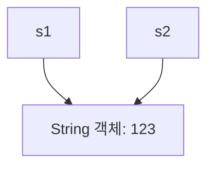
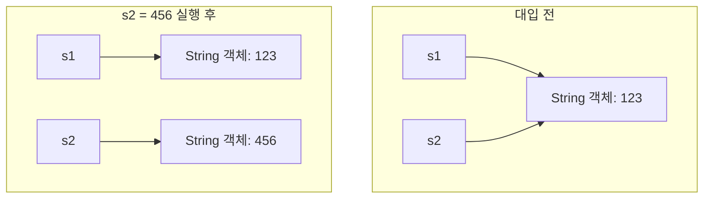
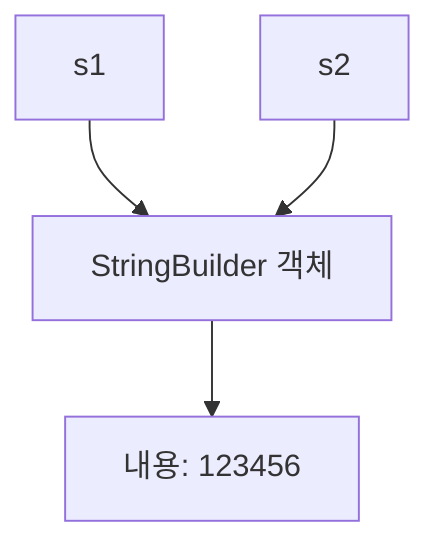
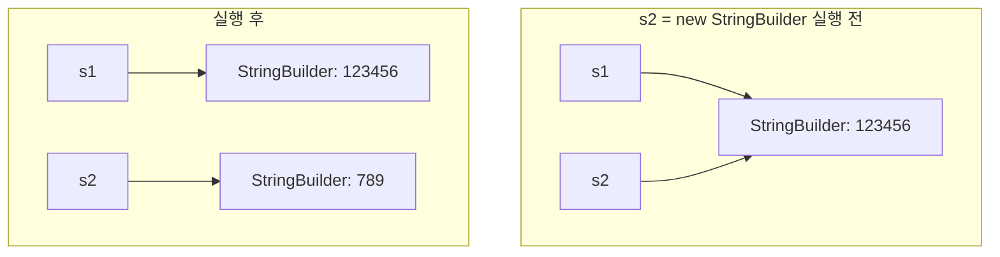

# Java의 참조값과 객체 변경

## 1. 참조형 변수의 대입

Java에서 참조형 변수에 다른 변수를 대입하면 객체 자체가 복사되는 것이 아니라 **참조값이 복사**된다.

```java
String s1 = "123";
String s2 = s1;
```

이때 `s1`과 `s2`는 같은 `String` 객체를 참조한다.



```java
System.out.println(s1 == s2); // true
```

`==`는 두 참조가 동일한 객체를 가리키는지 비교한다.

여기서 중요한 점은 `s1`과 `s2`가 같은 객체를 참조한다고 해서, 한 변수에 새로운 값을 대입했을 때 다른 변수도 함께 바뀌는 것은 아니라는 것이다.

---

## 2. 참조 변수에 새로운 값을 대입하면?

```java
String s1 = "123";
String s2 = s1;

s2 = "456";
```

`s2 = "456"`은 기존 객체의 내용을 변경하는 것이 아니다. `s2`가 참조하는 대상을 변경하는 것이다.



```java
System.out.println(s1); // 123
System.out.println(s2); // 456
```

`s1`은 기존 객체를 계속 참조하고, `s2`만 다른 문자열을 참조하게 된다.

**핵심:** 참조 변수에 새로운 값을 대입하는 것과, 참조가 가리키는 객체의 상태를 변경하는 것은 서로 다른 동작이다.

---

## 3. String은 불변(Immutable) 객체다

Java의 `String`은 생성된 이후 문자열 내용을 직접 변경할 수 없다.

```java
String s1 = "123";
String s2 = s1;

s2 = "456";
```

이 코드에서는 기존 `"123"` 객체의 내용이 변경되지 않는다. `s2`가 다른 문자열을 참조하도록 바뀔 뿐이다.

문자열을 연결하는 경우도 마찬가지다.

```java
String s1 = "123";
s1 = s1 + "456";

System.out.println(s1); // 123456
```

기존 `"123"` 객체를 수정하는 것이 아니라, 연결 결과를 나타내는 새로운 문자열을 만들고 `s1`이 그 결과를 참조하도록 변경한다.

### String이 불변인 이유

- **안전성:** 문자열을 공유해도 다른 코드가 내용을 직접 변경할 수 없다.
- **공유 효율성:** 동일한 문자열 객체를 여러 곳에서 참조할 수 있다.
- **신뢰성:** 문자열의 내용이 변경되어 발생하는 예기치 않은 부작용을 방지한다.

---

## 4. StringBuilder는 가변(Mutable) 객체다

`String`과 달리 `StringBuilder`는 객체의 내부 내용을 변경할 수 있다.

```java
StringBuilder s1 = new StringBuilder("123");
StringBuilder s2 = s1;

s2.append("456");

System.out.println(s1); // 123456
System.out.println(s2); // 123456
```

`s1`과 `s2`는 같은 `StringBuilder` 객체를 참조한다. `s2.append("456")`은 참조 대상을 바꾸는 것이 아니라, 공유하는 객체의 내부 내용을 변경한다.



두 변수 모두 같은 객체를 참조하므로, 어느 변수로 접근하든 변경된 내용을 확인할 수 있다.

### 참조 변경과 객체 변경의 차이

```java
StringBuilder s1 = new StringBuilder("123");
StringBuilder s2 = s1;

// 객체의 내용 변경
s2.append("456");

// 참조 대상 변경
s2 = new StringBuilder("789");
```

첫 번째 작업은 `s1`과 `s2`가 공유하는 객체의 내용을 변경한다. 두 번째 작업은 `s2`만 새로운 객체를 참조하도록 변경한다.



```java
System.out.println(s1); // 123456
System.out.println(s2); // 789
```

---

## 5. C++의 std::string과 비교

```cpp
std::string s1 = "123";
std::string s2 = s1;

s2[0] = '9';

std::cout << s1; // 123
std::cout << s2; // 923
```

일반적인 `std::string` 복사에서는 별개의 문자열 객체가 만들어지며, 각 문자열은 독립적으로 수정할 수 있다.

반면 Java에서는 다음과 같이 동작한다.

```java
StringBuilder s1 = new StringBuilder("123");
StringBuilder s2 = s1;

s2.setCharAt(0, '9');

System.out.println(s1); // 923
System.out.println(s2); // 923
```

Java의 참조형 변수 대입은 객체를 복사하지 않고 참조값을 복사한다. 따라서 가변 객체를 공유하면 한쪽에서 변경한 내용이 다른 쪽에서도 보인다.

| 구분 | C++ `std::string` 복사 | Java `String` 대입 | Java `StringBuilder` 대입 |
|---|---|---|---|
| 대입 시 동작 | 문자열 값 복사 | 참조값 복사 | 참조값 복사 |
| 객체 공유 | 일반적인 복사에서는 공유하지 않음 | 공유 가능 | 공유 가능 |
| 내용 변경 | 가능 | 불가능 | 가능 |
| 한쪽에서 객체 내용을 변경하면 | 복사본은 독립적 | 직접 변경 불가 | 공유하는 변수에서도 변경된 상태 확인 가능 |

---

## 6. 핵심 정리

| 작업 | 의미 |
|---|---|
| `s2 = s1` | 참조값을 복사하여 같은 객체를 참조 |
| `s2 = "456"` | `s2`가 참조하는 대상을 변경 |
| `s2.append("456")` | 공유하는 `StringBuilder` 객체의 내용 변경 |
| `s2 = new StringBuilder("789")` | `s2`가 새로운 객체를 참조 |
| `String`에 문자열 연결 | 새로운 문자열 결과를 만들고 참조를 변경 |

### 기억할 원칙

1. Java의 참조형 변수 대입은 객체 복사가 아니라 참조값 복사다.
2. 참조 변수에 새로운 객체를 대입해도 다른 변수의 참조는 바뀌지 않는다.
3. 가변 객체를 공유하면 한쪽에서 변경한 객체의 상태를 다른 쪽에서도 확인할 수 있다.
4. `String`은 불변 객체이므로 내용을 직접 변경할 수 없지만, `StringBuilder`는 가변 객체이므로 내용을 변경할 수 있다.

**결론:** 같은 객체를 참조하는지와 객체의 내용을 변경할 수 있는지는 별개의 문제다. Java에서는 참조 공유와 객체의 가변성을 함께 고려해야 한다.