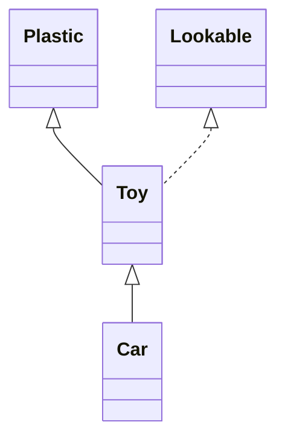

# Java 제네릭 와일드카드 (Wildcard)

## 📌 1. 와일드카드란?

와일드카드(`?`)는 제네릭에서 **구체적인 타입을 지정하지 않고, 특정 조건을 만족하는 여러 타입을 허용하기 위해 사용하는 문법**이다.

와일드카드는 크게 세 가지 형태로 구분된다.

| 종류 | 문법 | 의미 |
|---|---|---|
| 비제한 와일드카드 | `<?>` | 모든 타입 허용 |
| 상한 제한 와일드카드 | `<? extends T>` | T 또는 T의 하위 타입 허용 |
| 하한 제한 와일드카드 | `<? super T>` | T 또는 T의 상위 타입 허용 |

이번 문서에서는 상한 제한과 하한 제한 와일드카드를 중심으로 살펴본다.

---

## 🧱 2. 예제에서 사용할 클래스 구조

먼저 다음과 같은 클래스와 인터페이스가 있다고 가정한다.

```java
class Plastic {}

interface Lookable {}

class Toy extends Plastic implements Lookable {}

class Car extends Toy {}
```

상속 및 구현 관계는 다음과 같다.



각 타입의 관계를 정리하면 다음과 같다.

| 타입 | 관계 |
|---|---|
| Plastic | Toy의 상위 클래스 |
| Lookable | Toy가 구현하는 인터페이스 |
| Toy | Plastic을 상속하고 Lookable을 구현 |
| Car | Toy의 하위 클래스 |

따라서 `Toy`의 상위 타입에는 `Plastic`, `Lookable` 등이 포함된다.

제네릭 클래스는 다음과 같이 작성한다.

```java
class Box<T> {
    private T ob;

    public void set(T o) {
        ob = o;
    }

    public T get() {
        return ob;
    }
}
```

---

## 🔍 3. 제네릭의 불공변성 (Invariance)

와일드카드를 이해하기 전에 먼저 알아야 하는 개념이다.

Java의 제네릭은 기본적으로 **불공변성**을 가진다.

예를 들어 `Toy`가 `Plastic`을 상속한다고 해서 다음 관계가 성립하는 것은 아니다.

```java
Box<Toy> toyBox = new Box<>();

// 컴파일 오류
// Box<Plastic> plasticBox = toyBox;
```

일반적인 상속 관계에서는 하위 클래스의 객체를 상위 클래스 타입의 참조 변수로 받을 수 있다.

```java
Toy toy = new Toy();

Plastic plastic = toy; // 가능
```

하지만 제네릭에서는 타입 인자까지 자동으로 상속 관계가 적용되지 않는다.

즉,

```java
Toy extends Plastic
```

이라는 관계가 있어도,

```java
Box<Toy>
Box<Plastic>
```

사이에 상속 관계가 생기는 것은 아니다.

그렇다면 `Box<Toy>`와 `Box<Plastic>`을 모두 처리해야 하는 경우에는 어떻게 해야 할까?

이때 사용하는 것이 와일드카드다.

---

## ⬆️ 4. 상한 제한 와일드카드 (`? extends T`)

### 4-1. 기본 개념

```java
Box<? extends Toy>
```

`? extends Toy`는 실제 타입 인자가 **Toy 또는 Toy의 하위 타입**이라는 의미다.

앞에서 정의한 클래스 구조에서는 다음 타입을 허용한다.

```java
Box<Toy>
Box<Car>
```

반면 다음 타입은 허용하지 않는다.

```java
Box<Plastic>   // 불가능
Box<Lookable>  // 불가능
Box<Object>   // 불가능
```

`Plastic`, `Lookable`, `Object`는 `Toy`의 상위 타입이기 때문이다.

### 4-2. 값 꺼내기 (get)

```java
public static void outBox(Box<? extends Toy> box) {
    Toy toy = box.get();           // 가능
    Plastic plastic = box.get();  // 가능
    Lookable lookable = box.get(); // 가능
}
```

`get()`을 통해 꺼낸 값을 `Toy`, `Plastic`, `Lookable` 타입으로 받을 수 있다.

그 이유는 실제 타입이 다음 중 하나이기 때문이다.

- `Box<Toy>`
- `Box<Car>`

실제 타입이 `Box<Toy>`라면 반환값은 `Toy`다.

실제 타입이 `Box<Car>`라면 반환값은 `Car`다.

`Car`는 `Toy`의 하위 타입이므로, 두 경우 모두 반환값을 `Toy`로 취급할 수 있다.

또한 `Toy`는 `Plastic`의 하위 타입이면서 `Lookable`을 구현하고 있으므로, 이 두 타입으로도 안전하게 받을 수 있다.

### 4-3. 값 넣기 (set)

```java
public static void outBox(Box<? extends Toy> box) {
    // box.set(new Toy()); // 컴파일 오류
    // box.set(new Car()); // 컴파일 오류

    box.set(null); // 가능
}
```

`set()`으로 `Toy`나 `Car` 객체를 전달할 수 없다.

그 이유는 실제 타입이 `Box<Car>`일 가능성이 있기 때문이다.

예를 들어 다음과 같은 상황을 생각해 보자.

```java
Box<Car> carBox = new Box<>();
```

이 Box에는 `Car` 객체를 저장할 수 있지만, 일반적인 `Toy` 객체는 저장할 수 없다.

```java
carBox.set(new Car()); // 가능
carBox.set(new Toy()); // 컴파일 오류
```

따라서 컴파일러는 `? extends Toy`로 참조하는 객체에 `Toy`나 `Car`를 전달하는 것을 허용하지 않는다.

단, `null`은 모든 참조 타입에 대입할 수 있으므로 예외적으로 입력할 수 있다.

### ✅ 상한 제한 정리

| 작업 | 가능 여부 |
|---|---|
| `Toy toy = box.get()` | 가능 |
| `Plastic p = box.get()` | 가능 |
| `Lookable l = box.get()` | 가능 |
| `box.set(new Toy())` | 불가능 |
| `box.set(new Car())` | 불가능 |
| `box.set(null)` | 가능 |

**핵심: `extends`는 데이터를 꺼내는 작업에 유리하다.**

---

## ⬇️ 5. 하한 제한 와일드카드 (`? super T`)

### 5-1. 기본 개념

```java
Box<? super Toy>
```

`? super Toy`는 실제 타입 인자가 **Toy 또는 Toy의 상위 타입**이라는 의미다.

앞에서 정의한 클래스 구조에서는 다음 타입을 허용한다.

```java
Box<Toy>
Box<Plastic>
Box<Lookable>
Box<Object>
```

`Toy`가 `Plastic`을 상속하고 `Lookable`을 구현하기 때문에 `Plastic`과 `Lookable` 모두 `Toy`의 상위 타입으로 인정된다.

반면 다음 타입은 허용하지 않는다.

```java
Box<Car> // 불가능
```

`Car`는 `Toy`의 하위 타입이기 때문이다.

### 5-2. 값 넣기 (set)

```java
public static void inBox(Box<? super Toy> box, Toy toy) {
    box.set(toy);          // 가능
    box.set(new Toy());    // 가능
    box.set(new Car());    // 가능
}
```

`set()`을 통해 `Toy`와 그 하위 타입인 `Car` 객체를 전달할 수 있다.

그 이유는 실제 타입이 다음 중 무엇이든 `Toy` 객체를 저장할 수 있기 때문이다.

| 실제 타입 | Toy 객체 저장 가능 여부 | 이유 |
|---|---|---|
| `Box<Toy>` | 가능 | 동일한 타입 |
| `Box<Plastic>` | 가능 | Toy는 Plastic의 하위 타입 |
| `Box<Lookable>` | 가능 | Toy는 Lookable을 구현 |
| `Box<Object>` | 가능 | Toy는 Object의 하위 타입 |

예를 들어 실제 타입이 `Box<Lookable>`이라면 다음과 같이 사용할 수 있다.

```java
Box<Lookable> lookableBox = new Box<>();

lookableBox.set(new Toy());
lookableBox.set(new Car());
```

`Toy`와 `Car`는 모두 `Lookable`을 구현하는 타입이므로 저장할 수 있다.

### 5-3. 값 꺼내기 (get)

```java
public static void inBox(Box<? super Toy> box, Toy toy) {
    box.set(toy);

    // Toy t = box.get();         // 컴파일 오류
    // Plastic p = box.get();    // 컴파일 오류
    // Lookable l = box.get();   // 컴파일 오류

    Object obj = box.get();      // 가능
}
```

여기서는 `get()`으로 반환되는 값을 `Toy`, `Plastic`, `Lookable` 타입으로 받을 수 없다.

왜 그럴까?

실제 타입이 다음 중 무엇인지 컴파일러가 확정할 수 없기 때문이다.

```java
Box<Toy>
Box<Plastic>
Box<Lookable>
Box<Object>
```

각각의 상황을 살펴보자.

**① 실제 타입이 `Box<Plastic>`인 경우**

```java
Box<Plastic> plasticBox = new Box<>();
```

이 Box에는 `Toy`뿐 아니라 일반적인 `Plastic` 객체도 저장할 수 있다.

```java
plasticBox.set(new Plastic());
```

따라서 `get()`의 반환값이 반드시 `Toy`라고 보장할 수 없다.

**② 실제 타입이 `Box<Lookable>`인 경우**

```java
Box<Lookable> lookableBox = new Box<>();
```

이 Box에는 `Toy`뿐 아니라 `Lookable`을 구현하는 다른 클래스의 객체도 저장할 수 있다.

따라서 반환값이 반드시 `Plastic`이라고 보장할 수 없다.

**③ 결론**

컴파일러는 실제 타입이 무엇인지 알 수 없으므로 특정 상위 타입인 `Plastic`이나 `Lookable`을 반환 타입으로 보장할 수 없다.

Java 컴파일러가 안전하게 보장하는 반환 타입은 `Object`다.

```java
Object obj = box.get(); // 가능
```

여기서 중요한 점은 `Toy`가 `Plastic`을 상속하고 `Lookable`을 구현한다는 사실만으로 `get()`의 반환값까지 두 타입 중 하나로 확정되지 않는다는 것이다.

### 5-4. 실제 사용 예시

```java
public class BoundedWildcardUsage {
    public static void main(String[] args) {
        Box<Toy> toyBox = new Box<>();
        Box<Plastic> plasticBox = new Box<>();
        Box<Lookable> lookableBox = new Box<>();
        Box<Car> carBox = new Box<>();

        BoxHandler.inBox(toyBox, new Toy());
        BoxHandler.inBox(plasticBox, new Toy());
        BoxHandler.inBox(lookableBox, new Toy());

        // 컴파일 오류
        // BoxHandler.inBox(carBox, new Toy());
    }
}
```

`Box<Toy>`, `Box<Plastic>`, `Box<Lookable>`은 모두 `? super Toy`의 조건을 만족한다.

반면 `Box<Car>`는 `Toy`의 하위 타입이므로 조건에 맞지 않는다.

### ✅ 하한 제한 정리

| 작업 | 가능 여부 |
|---|---|
| `box.set(new Toy())` | 가능 |
| `box.set(new Car())` | 가능 |
| `Object obj = box.get()` | 가능 |
| `Toy t = box.get()` | 불가능 |
| `Plastic p = box.get()` | 불가능 |
| `Lookable l = box.get()` | 불가능 |
| `box.set(null)` | 가능 |

**핵심: `super`는 데이터를 입력하는 작업에 유리하다.**

---

## 📊 6. 상한 제한과 하한 제한 비교

| 구분 | 상한 제한 | 하한 제한 |
|---|---|---|
| 문법 | `<? extends T>` | `<? super T>` |
| 허용하는 타입 | T 또는 하위 타입 | T 또는 상위 타입 |
| 값 입력 | 제한적 | T 및 하위 타입 입력 가능 |
| 값 출력 | T 및 상위 타입으로 받을 수 있음 | Object로만 안전하게 받을 수 있음 |
| 주요 용도 | 데이터 읽기 | 데이터 입력 |

※ 여기서 '값 출력'은 `get()`으로 반환된 값을 어떤 타입의 변수에 대입할 수 있는지를 의미한다.

### 🧠 기억하는 방법: PECS

PECS는 다음 표현의 약자다.

- **Producer Extends**: 데이터를 제공하는 역할이라면 `extends` 사용
- **Consumer Super**: 데이터를 전달받아 소비하는 역할이라면 `super` 사용

예를 들어 다음과 같이 이해할 수 있다.

```java
// 데이터를 꺼내 사용하는 경우
public static void outBox(Box<? extends Toy> box) {
    Toy toy = box.get();
}

// 데이터를 전달하는 경우
public static void inBox(Box<? super Toy> box, Toy toy) {
    box.set(toy);
}
```

---

## 💡 7. 실전 예시: List 데이터 복사

와일드카드는 실제 Java API에서도 활용된다.

다음은 하나의 List에서 데이터를 꺼내 다른 List에 복사하는 메서드다.

```java
import java.util.List;

public class ListCopy {

    public static <T> void copy(
            List<? extends T> source,
            List<? super T> destination) {

        for (T value : source) {
            destination.add(value);
        }
    }

    public static void main(String[] args) {
        List<Integer> source = List.of(10, 20, 30);
        List<Number> destination = new java.util.ArrayList<>();

        copy(source, destination);

        System.out.println(destination);
    }
}
```

출력 결과:

```text
[10, 20, 30]
```

각 매개변수에 와일드카드가 적용된 이유는 다음과 같다.

**① source: `List<? extends T>`**

Source는 데이터를 제공하는 역할이다.

따라서 `T` 또는 `T`의 하위 타입을 허용한다.

`Integer`는 `Number`의 하위 타입이므로 다음 호출이 가능하다.

```java
List<Integer> source = List.of(10, 20, 30);
```

반복문에서 꺼낸 값은 `T` 타입으로 취급할 수 있다.

**② destination: `List<? super T>`**

Destination은 데이터를 전달받는 역할이다.

따라서 `T` 또는 `T`의 상위 타입을 허용한다.

`Number`는 `Integer`의 상위 타입이므로 다음 호출이 가능하다.

```java
List<Number> destination = new ArrayList<>();
```

이처럼 Source에서는 값을 읽고 Destination에는 값을 넣는 구조이므로 `extends`와 `super`를 함께 사용한다.

이것이 PECS의 대표적인 활용 사례다.

---

## 🎯 8. 최종 핵심 정리

### ⬆️ `? extends T`

```java
Box<? extends Toy>
```

- Toy 또는 Toy의 하위 타입을 허용한다.
- `get()`으로 꺼낸 값을 Toy 타입으로 받을 수 있다.
- Toy의 상위 타입인 Plastic, Lookable로도 받을 수 있다.
- 실제 타입이 하위 타입일 수 있으므로 Toy나 Car 객체를 `set()`으로 전달할 수 없다.
- **값을 읽는 작업에 적합하다.**

### ⬇️ `? super T`

```java
Box<? super Toy>
```

- Toy 또는 Toy의 상위 타입을 허용한다.
- Toy와 그 하위 타입인 Car 객체를 `set()`으로 전달할 수 있다.
- 실제 타입이 Plastic일 수도, Lookable일 수도 있으므로 이들 중 특정 타입으로 `get()` 결과를 받을 수 없다.
- `get()`으로 꺼낸 값은 Object 타입으로만 안전하게 받을 수 있다.
- **값을 입력하는 작업에 적합하다.**

### 한 문장으로 기억하기

> `extends`는 상한을 제한하여 안전하게 읽을 수 있도록 하고, `super`는 하한을 제한하여 안전하게 입력할 수 있도록 한다.

