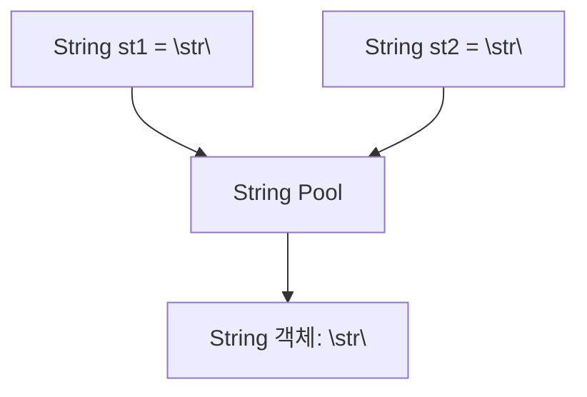
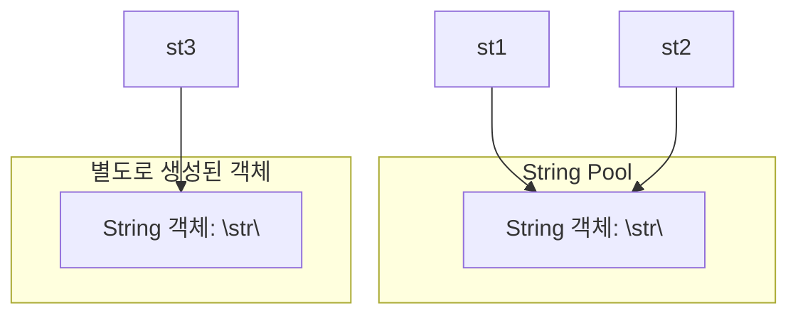
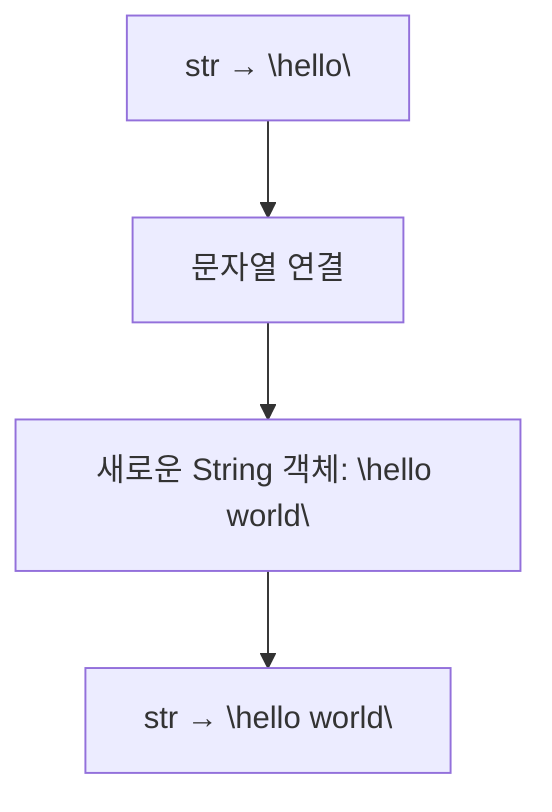

# Java String과 String Pool

## 1. String 객체의 생성 방식

Java에서 문자열을 생성하는 대표적인 방법은 문자열 리터럴을 사용하는 방식과 `new String()`을 사용하는 방식이다.

```java
String st1 = "str";
String st2 = new String("str");
```

두 방식 모두 `String` 인스턴스를 사용하지만, **기존 객체를 재사용할 수 있는지, 별도의 객체를 생성하는지**에 차이가 있다.

### 1.1 문자열 리터럴 사용

```java
String st1 = "str";
String st2 = "str";
```

문자열 리터럴은 JVM이 관리하는 String Pool을 통해 관리된다.

- 해당 문자열이 String Pool에 없다면 객체가 생성되어 등록된다.
- 이미 동일한 문자열 리터럴이 존재한다면 기존 객체를 재사용한다.
- 따라서 같은 리터럴을 사용한 변수들은 동일한 객체를 참조할 수 있다.



위 코드에서 `st1`과 `st2`는 같은 `String` 객체를 참조한다.

```java
System.out.println(st1 == st2); // true
```

### 1.2 `new String()` 사용

```java
String st1 = "str";
String st2 = new String("str");
```

`new String("str")`은 새로운 `String` 인스턴스를 명시적으로 생성한다.

여기서 `"str"` 자체는 문자열 리터럴이므로 String Pool의 객체를 사용한다. 그러나 `new String()`은 그 객체와 별개인 새로운 `String` 인스턴스를 생성한다.

```mermaid
flowchart TD
    A["String st1 = \"str\""]
    B["String st2 = new String(\"str\")"]
    C["String Pool"]
    D["String 객체: \"str\""]
    E["별도의 String 객체: \"str\""]

    A --> D
    D --- C
    B --> E
    B -. 내부 리터럴 .-> D
```

따라서 `st1`과 `st2`는 내용이 같지만 서로 다른 객체를 참조한다.

```java
System.out.println(st1 == st2); // false
System.out.println(st1.equals(st2)); // true
```

## 2. 참조 변수와 String 객체

다음 코드를 살펴보자.

```java
String st1 = "str";
String st2 = "str";
String st3 = new String("str");
```

객체와 변수의 관계를 구분하면 다음과 같다.



| 변수 | 참조하는 객체 | 설명 |
|---|---|---|
| `st1` | String Pool의 `"str"` 객체 | 리터럴 사용 |
| `st2` | String Pool의 `"str"` 객체 | 기존 객체 재사용 |
| `st3` | 별도로 생성된 String 객체 | `new String()` 사용 |

여기서 `st1`, `st2`, `st3`은 객체 자체가 아니라 객체를 참조하는 변수다.

## 3. `==`와 `equals()`의 차이

Java에서 두 문자열을 비교할 때는 비교 목적에 따라 연산자를 구분해야 한다.

### 3.1 `==`: 참조 동일성 비교

참조형 변수에 `==`를 사용하면 두 변수가 동일한 객체를 참조하는지 비교한다.

```java
String st1 = "str";
String st2 = "str";
String st3 = new String("str");

System.out.println(st1 == st2); // true
System.out.println(st1 == st3); // false
```

- `st1 == st2`: 같은 객체를 참조하므로 `true`
- `st1 == st3`: 서로 다른 객체를 참조하므로 `false`

### 3.2 `equals()`: 문자열 내용 비교

`String` 클래스는 `equals()`를 오버라이딩하여 문자열의 내용을 비교하도록 구현되어 있다.

```java
String st1 = "str";
String st2 = new String("str");

System.out.println(st1.equals(st2)); // true
```

두 변수가 서로 다른 객체를 참조하더라도 문자열의 내용이 같으면 `true`를 반환한다.

| 비교 방법 | 비교 대상 |
|---|---|
| `st1 == st2` | 동일한 객체를 참조하는지 |
| `st1.equals(st2)` | 문자열의 내용이 같은지 |

**문자열의 내용이 같은지 확인하려면 일반적으로 `equals()`를 사용한다.**

## 4. String은 불변 객체(Immutable)다

`String` 객체는 생성된 후 내부 문자열의 내용을 변경할 수 없다.

```java
String str = "hello";
str = str + " world";
```

위 코드에서 기존 `"hello"` 객체의 내용이 변경되는 것은 아니다. 문자열을 연결한 새로운 결과가 만들어지고, `str`이 그 결과를 참조하도록 변경된다.



이러한 불변성은 String Pool에서 문자열 객체를 여러 곳에서 공유할 때 안전성을 제공한다.

문자열을 반복적으로 수정하거나 연결해야 한다면 `StringBuilder`를 사용하는 것이 적합할 수 있다.

## 5. 핵심 정리

- 문자열 리터럴은 String Pool을 통해 관리된다.
- 같은 리터럴은 기존 객체를 재사용할 수 있다.
- `new String("str")`은 별도의 `String` 인스턴스를 생성한다.
- 문자열 리터럴을 사용했다고 해서 매번 새로운 인스턴스가 생성되는 것은 아니다.
- `==`는 참조 동일성을 비교하고, `equals()`는 문자열의 내용을 비교한다.
- `String`은 불변 객체이므로 문자열 내용을 직접 변경할 수 없다.

**핵심 개념:** 문자열 리터럴 방식은 String Pool의 객체를 재사용할 수 있고, `new String()` 방식은 별도의 인스턴스를 생성한다. 두 방식의 차이는 단순히 String Pool에 등록되는지 여부뿐 아니라 객체를 재사용하는지 여부에도 있다.