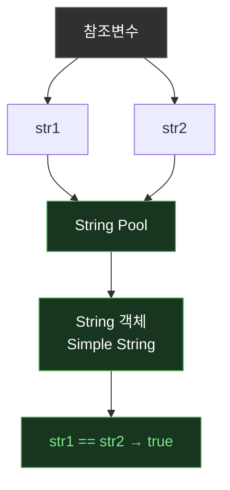
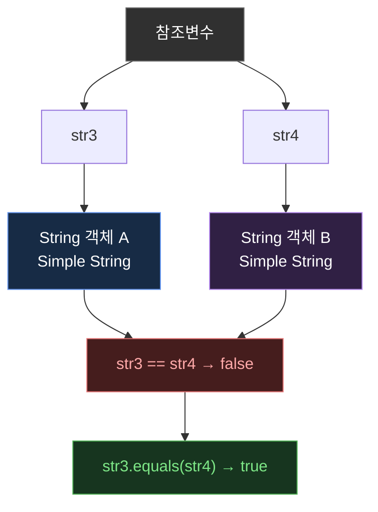

# 🔎 Java의 참조값 비교 (`==`)

## 1. 기본 개념

Java에서 `==` 연산자는 변수의 타입에 따라 비교 대상이 달라진다.

- **기본형(Primitive Type)**: 실제 값을 비교한다.
- **참조형(Reference Type)**: 두 변수가 같은 객체를 참조하는지 비교한다.

참조값은 객체를 참조하기 위해 사용하는 값이다. 흔히 메모리 주소에 비유하지만, Java의 참조값을 실제 메모리 주소와 동일하다고 단정하는 것은 정확하지 않다.

## 2. 기본형과 참조형의 차이

### 2-1. 기본형: 값 비교

```java
int a = 10;
int b = 10;

System.out.println(a == b); // true
```

두 변수에 저장된 값이 모두 `10`이므로 `true`를 반환한다.

### 2-2. 참조형: 참조값 비교

```java
String str1 = new String("Hello");
String str2 = new String("Hello");

System.out.println(str1 == str2); // false
```

두 문자열의 내용은 같지만, `new String()`으로 각각 새로운 객체를 생성했으므로 서로 다른 객체를 참조한다.

## 3. String의 비교 방식

Java의 `String`은 참조형이므로 `==`와 `equals()`의 차이를 이해해야 한다.

| 비교 방식 | 비교 대상 | 설명 |
|---|---|---|
| `==` | 참조값 | 같은 객체를 참조하는지 비교 |
| `equals()` | 문자열 내용 | 문자열의 내용이 같은지 비교 |

### 3-1. 문자열 리터럴과 String Pool

```java
String str1 = "Simple String";
String str2 = "Simple String";

System.out.println(str1 == str2); // true
```

Java는 문자열 리터럴을 String Pool에서 관리한다. 동일한 문자열 리터럴이 이미 존재하면 같은 문자열 객체를 재사용할 수 있다.

따라서 `str1`과 `str2`는 같은 객체를 참조한다.



### 3-2. `new String()`을 사용한 객체 생성

```java
String str3 = new String("Simple String");
String str4 = new String("Simple String");

System.out.println(str3 == str4);      // false
System.out.println(str3.equals(str4)); // true
```

`new String()`은 호출할 때마다 새로운 `String` 객체를 생성한다. 따라서 두 변수는 서로 다른 객체를 참조한다.



- `==`: 서로 다른 객체를 참조하므로 `false`
- `equals()`: 문자열의 내용이 같으므로 `true`

## 4. 전체 예제

```java
public class ImmutableString {
    public static void main(String[] args) {
        String str1 = "Simple String";
        String str2 = "Simple String";

        String str3 = new String("Simple String");
        String str4 = new String("Simple String");

        System.out.println(str1 == str2);      // true
        System.out.println(str3 == str4);      // false

        System.out.println(str1.equals(str2)); // true
        System.out.println(str3.equals(str4)); // true
    }
}
```

### 실행 결과

```text
true
false
true
true
```

## 5. `equals()` 사용 시 주의점

`equals()`는 모든 클래스에서 자동으로 객체의 내용을 비교하는 것은 아니다.

`Object` 클래스에 정의된 기본 `equals()`는 동일한 객체인지 비교하며, 각 클래스가 필요에 따라 이를 재정의할 수 있다.

`String` 클래스는 `equals()`를 재정의하여 문자열의 내용을 비교한다.

따라서 다른 클래스의 객체를 비교할 때는 해당 클래스의 `equals()` 구현을 확인해야 한다.

## 6. C++과의 차이

C++의 `std::string`은 `==` 연산자가 문자열의 내용을 비교하도록 오버로딩되어 있다.

```cpp
string str1 = "Hello";
string str2 = "Hello";

cout << (str1 == str2); // 1 (true)
```

반면 Java에서는 참조형 변수의 `==`가 동일한 객체를 참조하는지 비교한다.

```java
String str1 = new String("Hello");
String str2 = new String("Hello");

System.out.println(str1 == str2);      // false
System.out.println(str1.equals(str2)); // true
```

| 구분 | C++ `std::string` | Java `String` |
|---|---|---|
| `==` | 문자열 내용 비교 | 참조값 비교 |
| 내용 비교 | `str1 == str2` | `str1.equals(str2)` |
| 연산자 오버로딩 | 지원 | 지원하지 않음 |

## 💡 핵심 정리

- 기본형의 `==`는 값을 비교한다.
- 참조형의 `==`는 같은 객체를 참조하는지 비교한다.
- 동일한 문자열 리터럴은 String Pool의 객체를 공유할 수 있다.
- `new String()`은 새로운 `String` 객체를 생성한다.
- 문자열 내용 비교에는 `equals()`를 사용한다.
- `equals()`의 비교 방식은 해당 클래스의 구현에 따라 달라진다.
